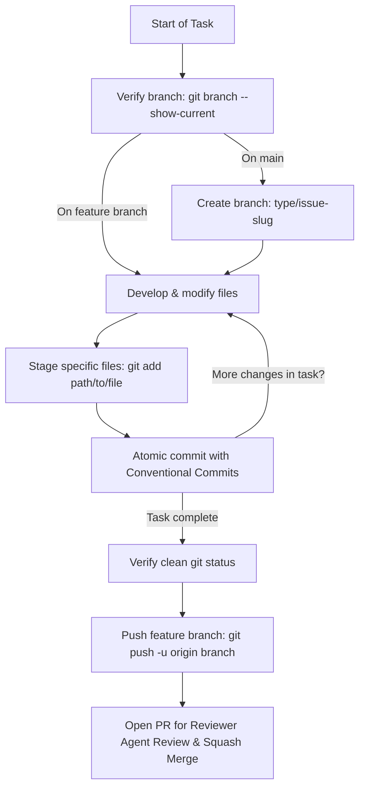

# Git Agent Skill

Adapted from FrioAndes reference standards.

Specialized skill for managing source control, branch lifecycles, and commit hygiene according to **Trunk-Based Development (TBD)** and **Conventional Commits**.

---

## Non-Negotiable Directives

1. **Strict Zero-Emoji Policy**: Emojis are strictly forbidden across all branches, commit messages, PR descriptions, documentation, code, and agent responses. Use clean, professional plain text only.
2. **PROHIBITED to commit directly to `main`**: `main` is the production trunk and must remain deployable at all times.
3. **Mandatory branch verification**: Before writing or modifying any code, verify current branch with `git branch --show-current`. If on `main`, immediately create a short-lived branch `<type>/<issue-number>-<slug>`.
4. **Short-Lived Branches (SLB)**: Feature branches must have a lifespan under 48 hours and diffs under 400 lines where possible.
5. **Continuous, Atomic Commits**: As files and logical units are modified or created, stage and commit them immediately. Do not defer all commits to the end of the session.
6. **Strict Conventional Commits**: `<type>(<scope>): <lowercase imperative subject>`. Headers must not exceed 72 characters, must not end with a period, and must not contain emojis. A `Refs #<issue>` footer is mandatory.
7. **Agent Publishing Boundary**: Agents commit locally as work proceeds and may push only their own feature branch to open a PR. Agents never push to `main`, never force-push, and never create repositories. Implementer agents never merge. The designated reviewer agent, which runs on a different AI provider than the implementer, reviews the pull request and squash-merges it when it approves and every check is green, following the review protocol. A pull request that needs a business decision, weakens CI checks or deletes out-of-scope content goes to the human lead instead. The reviewer may delete the merged head branch. The human lead can still review or merge at any time.
8. **All English**: All commit messages, branch names, PR descriptions, and agent communications must be in English.

---

## Workflow Execution Lifecycle



---

## Step-by-Step Instructions

### Step 1: Branch Verification & Initialization
```bash
git branch --show-current
git status --short
```
If output is `main`:
```bash
git pull origin main
git checkout -b <type>/<issue-number>-<slug>
```
*Valid types*: `feat/`, `fix/`, `docs/`, `refactor/`, `chore/`, `perf/`, `test/`, `ci/`, `revert/`.

### Step 2: In-Progress Atomic Commits
As each logical file or unit is developed:
```bash
git status --short
git add <path/to/changed-files>
git commit -m "<type>(<scope>): <subject>" -m "<why this change was made>" -m "Refs #<issue-number>"
```

### Step 3: Push Feature Branch & Open PR
When all acceptance criteria are verified:
```bash
git status
git log -n 5 --oneline
git push -u origin <type>/<issue-number>-<slug>
```

Deliver PR details formatted according to `.github/pull_request_template.md`:
- Title: `<type>(<scope>): <subject>`
- What and why
- Issue reference: `Refs #<issue>` or `Closes #<issue>`
- Verification commands and results
- Risk and rollback
