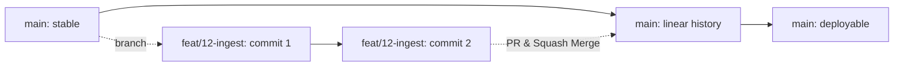

# Git Workflow & Source Control Standards

Adapted from FrioAndes reference standards.

This document establishes the Trunk-Based Development (TBD) workflow, branch lifecycle, commit conventions, and agent publishing boundaries for the Aroma Pacífico project.

---

## 1. Core Principles of Trunk-Based Development



### Trunk Stability (`main`)
- The `main` branch is the canonical trunk and must remain releasable at all times.
- Direct commits to `main` are strictly prohibited for both human developers and AI agents.
- All changes enter `main` exclusively through pull requests that pass CI checks and receive review approval.

### Short-Lived Feature Branches (SLB)
- Branches exist solely for the duration of a focused task or issue.
- **Lifespan**: Feature branches must live less than 48 hours. If a task exceeds this limit, decompose it into smaller milestones.
- **Size constraint**: Keep pull request diffs under ~400 lines of change to facilitate focused, thorough peer review.

### Branch Naming Conventions
Branch names must strictly adhere to the lowercase kebab-case pattern:
```text
<type>/<issue-number>-<short-kebab-slug>
```

#### Allowed Types:
- `feat/`: New feature or capability (e.g., `feat/12-telemetry-ingestion`)
- `fix/`: Defect repair or bug fix (e.g., `fix/34-sensor-boundary`)
- `docs/`: Documentation additions or revisions (e.g., `docs/5-architecture-overview`)
- `refactor/`: Code improvements without behavior changes (e.g., `refactor/18-clean-locals`)
- `chore/`: Maintenance, configuration, or dependency updates (e.g., `chore/0-bootstrap-agent-rules`)
- `test/`: Adding or updating test suites (e.g., `test/22-unit-tests`)
- `perf/`: Performance enhancements (e.g., `perf/29-query-tuning`)
- `ci/`: Continuous Integration workflow changes (e.g., `ci/8-pr-conventions`)
- `revert/`: Reverting a previous commit (e.g., `revert/41-undo-ingress-change`)

---

## 2. Conventional Commits Specification

All commit messages must comply with the [Conventional Commits v1.0.0](https://www.conventionalcommits.org/) specification in English.

```text
<type>(<scope>): <lowercase imperative subject (max 72 chars, NO EMOJIS)>

[optional body explaining why this change was made, wrapped at 72 chars]

Refs #<issue-number>
```

### 1. Types
- `feat`: A new feature (triggers minor version bump)
- `fix`: A bug fix (triggers patch version bump)
- `docs`: Documentation changes only
- `refactor`: Code change that neither fixes a bug nor adds a feature
- `perf`: Performance improvement
- `test`: Adding or correcting tests
- `build`: Build system, packaging, or external dependencies
- `ci`: CI configuration and pipeline scripts
- `chore`: Repository maintenance, configuration, housekeeping
- `revert`: Reverting a previous commit

### 2. Subject Line Rules
1. **Imperative mood**: Use verbs like "add", "fix", "update", "remove", "refactor" (not "added" or "fixes").
2. **Length limit**: Maximum 72 characters on the subject line.
3. **No trailing punctuation**: Never end the subject with a period (`.`).
4. **Lowercase**: Start subject with a lowercase letter after the colon and space.
5. **Strict Zero-Emoji rule**: No emojis in commit titles, descriptions, bodies, or footers.

### 3. Body and Footers
- Leave a blank line between header and body.
- Focus on **why** the change was made and any technical trade-offs, rather than repeating what files changed.
- Wrap body text at 72 characters.
- **Refs footer is required**: Reference the issue number as `Refs #<issue>` (or `Closes #<issue>`).

---

## 3. Strict Zero-Emoji Mandate

Emojis are strictly prohibited across all source control and collaboration surfaces:
- Commit message titles, bodies, and footers
- Branch names and git tags
- Pull Request titles and descriptions
- Source code comments, docstrings, and documentation files
- AI agent responses and tool outputs

---

## 4. Agent Publishing Model

This repository operates an adapted publishing protocol for AI agents:
1. **Local Commits**: Agents stage and commit locally as logical units of work are completed. Incremental commits are required; do not accumulate all changes into a single bulk commit at the end.
2. **Branch Push**: Agents may push only their own assigned feature branch (`<type>/<issue>-<slug>`) to the remote repository.
3. **Pull Request Creation**: Agents may open a Pull Request targeting `main`.
4. **Prohibited Actions**: Agents must **never** push directly to `main`, **never** execute force-push (`git push --force`), and **never** create remote repositories. Implementer agents **never** merge a pull request.
5. **Review and Merge**: Implementer agents never merge. The designated reviewer agent, which runs on a different AI provider than the implementer, reviews the pull request and squash-merges it when it approves and every check is green, following the review protocol. A pull request that needs a business decision, weakens CI checks or deletes out-of-scope content goes to the human lead instead. The reviewer may delete the merged head branch. The human lead can still review or merge at any time.

---

## 5. Daily Step-by-Step Protocol

### Step 1: Branch Verification & Creation
```bash
# Verify current branch is clean and on main
git checkout main
git pull origin main
git checkout -b <type>/<issue-number>-<slug>
```

### Step 2: Incremental Atomic Commits
As each file or logical unit is completed and verified:
```bash
git status --short
git add <path/to/files>
git commit -m "<type>(<scope>): <subject>" -m "<why this change was made>" -m "Refs #<issue-number>"
```

### Step 3: Feature Branch Push & PR
When all acceptance criteria are met and verified:
```bash
git status
git log -n 5 --oneline
git push -u origin <type>/<issue-number>-<slug>
```
Open a Pull Request using `.github/pull_request_template.md`.

### Step 4: Squash Merge and Cleanup
Implementer agents never merge. The designated reviewer agent, which runs on a different AI provider than the implementer, reviews the pull request and squash-merges it when it approves and every check is green, following the review protocol. A pull request that needs a business decision, weakens CI checks or deletes out-of-scope content goes to the human lead instead. The reviewer may delete the merged head branch. The human lead can still review or merge at any time.

Local working copies synchronize with trunk:
```bash
git checkout main
git pull origin main
git branch -d <type>/<issue-number>-<slug>
```
